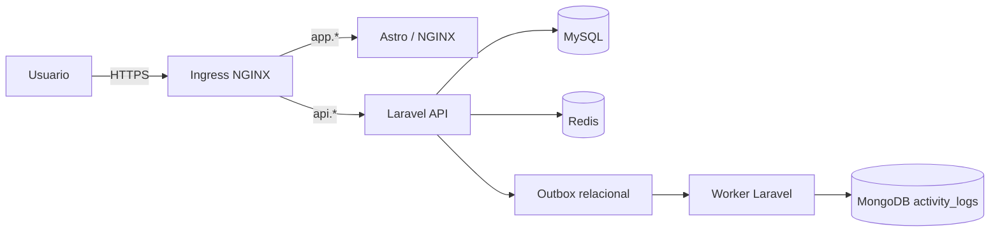

# Proyecto Kubernet - Fitness

Aplicación web para gestionar rutinas y sesiones de entrenamiento. El frontend está construido
con Astro y NGINX; la API usa Laravel. MySQL es la fuente de verdad, Redis sirve caché, sesión y
cola, y MongoDB conserva la bitácora de actividad. La infraestructura se define con Kustomize y
se ejecuta en dos perfiles Minikube aislados.

## Arquitectura



La transacción de negocio se guarda en MySQL junto con un evento en `activity_outbox`. El
worker entrega ese evento a MongoDB con `event_id` como clave idempotente. Si MongoDB no está
disponible, el evento queda pendiente y se procesa después con `php artisan activity:reconcile`.
Esto reduce el riesgo de pérdida de eventos entre ambos motores; no sustituye la alta
disponibilidad de las bases de datos.

## Ambientes

| Ambiente | Contexto | Namespace | Réplicas de aplicación | URLs TLS locales |
| --- | --- | --- | --- | --- |
| Desarrollo | `minikube` | `fitness-dev` | frontend, backend y worker: 1 | `app.dev.local`, `api.dev.local` |
| Producción de laboratorio | `proyecto-prof` | `fitness-prod` | frontend, backend y worker: 2; HPA backend 2-6 | `app.prod.local`, `api.prod.local` |

Los ambientes no comparten Secrets, PVC, credenciales ni datos. `proyecto-prof` es un clúster de
laboratorio de tres nodos sobre un solo host, no producción real.

## Componentes de infraestructura

- Ingress NGINX con terminación TLS y redirección HTTPS.
- StatefulSets MySQL 8.4 y MongoDB 8.0 con PVC independientes de 5 GiB.
- Redis sin persistencia para caché, sesión y colas.
- HPA del backend entre 2 y 6 réplicas, PDB para frontend y backend, y distribución de backend
  entre nodos en el overlay productivo.
- Pod Security `restricted`, contenedores sin privilegios y NetworkPolicies de denegación inicial.
- Prometheus, Grafana, Loki y Alloy para observabilidad; MySQL y MongoDB exponen métricas mediante
  exporters dedicados.
- Respaldos cifrados en almacenamiento de objetos, con restauración aislada y checksum SHA-256.

## Requisitos

- Docker Desktop en ejecución.
- `kubectl` y Minikube con driver Docker.
- Certificados TLS locales y Secrets creados fuera de Git.
- Para observabilidad: Helm, si se instalará `kube-prometheus-stack`, Loki o Alloy.

Compruebe los perfiles disponibles:

```powershell
kubectl config get-contexts
kubectl --context minikube get nodes
kubectl --context proyecto-prof get nodes
```

## Inicio rápido: desarrollo

1. Cree o inicie el perfil y habilite los addons necesarios:

   ```powershell
   minikube start --profile minikube --driver=docker
   minikube addons enable ingress --profile minikube
   minikube addons enable metrics-server --profile minikube
   ```

2. Cree `app-secrets` y `fitness-dev-tls` en `fitness-dev`. Nunca guarde valores reales en Git.
   Consulte [la guía de Secrets y despliegue](docs/secrets-and-deployment.md).

3. Construya e importe las imágenes:

   ```powershell
   docker build --build-arg PUBLIC_API_URL=https://api.dev.local:8443/api -t proyecto-kubernet/frontend:dev frontend
   docker build -t proyecto-kubernet/backend:dev backend
   minikube image load --profile minikube proyecto-kubernet/frontend:dev
   minikube image load --profile minikube proyecto-kubernet/backend:dev
   ```

4. Aplique el overlay y espere la migración:

   ```powershell
   kubectl --context minikube apply -k infra/overlays/dev
   kubectl --context minikube -n fitness-dev wait --for=condition=complete job/backend-migrate --timeout=300s
   kubectl --context minikube -n fitness-dev get pods,svc,pvc,job,ingress
   ```

Para probar TLS cuando el puerto local 443 esté ocupado, use un port-forward del controlador en
`8443:443`; el procedimiento completo está en la guía de despliegue.

## Producción de laboratorio

El overlay productivo usa referencias OCI por digest. No promueva etiquetas mutables como `dev` o
`latest`, ni copie PVC o Secrets desde desarrollo.

```powershell
.\tests\infrastructure\validate.ps1 -Environment prod
kubectl --context proyecto-prof apply -k infra/overlays/prod
kubectl --context proyecto-prof -n fitness-prod get pods,svc,pvc,hpa,pdb,ingress
```

Antes de una migración de esquema, valide compatibilidad hacia atrás. Para una nueva ejecución del
Job de migración, elimine de forma explícita el Job completado y vuelva a aplicar el overlay; no
ejecute migraciones concurrentes desde los Pods de aplicación.

## Validación y operación

Valide los manifiestos sin aplicar cambios al clúster:

```powershell
.\tests\infrastructure\validate.ps1 -Environment dev
.\tests\infrastructure\validate.ps1 -Environment prod
```

Consulte disponibilidad real antes de afirmar que un ambiente está sano:

```powershell
kubectl --context proyecto-prof -n fitness-prod get deploy,pods,hpa
kubectl --context proyecto-prof -n observability get pods
kubectl --context proyecto-prof -n fitness-prod get events --sort-by=.lastTimestamp
```

El HPA necesita que Metrics Server responda. Un objeto HPA existente no prueba por sí mismo que
haya escalado: revise `TARGETS`, eventos y réplicas disponibles.

## Respaldos y restauración

Los CronJobs `mysql-backup` y `mongodb-backup` generan dumps consistentes, calculan SHA-256 y los
cargan mediante `rclone` al remoto cifrado `backup-crypt:fitness/<namespace>/<motor>`. La retención
declarada es de 14 días. Los dumps se crean en `emptyDir`; no usan los PVC de MySQL/MongoDB ni un
PVC local como destino de respaldo.

El Secret `backup-object-storage` contiene el `rclone.conf` y debe crearse fuera de Git en cada
namespace. Las restauraciones se ejecutan únicamente en un namespace nuevo y aislado. Consulte:

- [Respaldos y restauración](docs/backups-and-recovery.md)
- [Plan D09 con RPO/RTO y resultados](docs/d09-plan-respaldos-restauracion-continuidad.md)
- [Bitácora de ejecución](docs/backup-execution-log.md)

Un PVC heredado llamado `database-backups` puede permanecer en clústeres creados con versiones
anteriores. No es parte del flujo actual; revíselo y elimínelo sólo después de confirmar que no
contiene datos que deban conservarse.

## Seguridad y límites

- Los tokens personales de Sanctum expiran a los 60 minutos mediante `SANCTUM_EXPIRATION`.
- Los Secrets se crean fuera del repositorio y se consumen mediante referencias Kubernetes.
- Las bases de datos no se exponen por Ingress, NodePort ni LoadBalancer.
- La política de red permite sólo DNS, el Ingress hacia la web, dependencias autorizadas del backend,
  el remoto de respaldos y el scrape de exporters.
- MySQL, MongoDB e Ingress son de una sola réplica en este laboratorio. Un fallo del host o del
  control plane sigue siendo un riesgo; el almacenamiento remoto protege las copias, no aporta alta
  disponibilidad al clúster.

## Documentación relacionada

- [Arquitectura](docs/architecture.md)
- [Secrets y despliegue](docs/secrets-and-deployment.md)
- [Promoción de imágenes](docs/image-promotion.md)
- [Bitácora de implementación](docs/implementation-log.md)
- [Respaldos y restauración](docs/backups-and-recovery.md)
