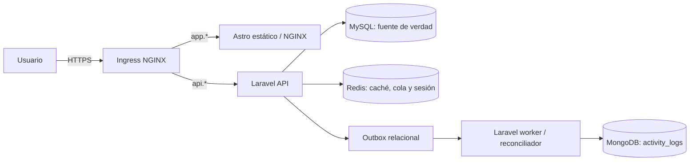

# Arquitectura y decisiones

## Aplicación



MySQL conserva la transacción de negocio. Los observers guardan un evento con UUID en
`activity_outbox`; el worker lo escribe en MongoDB usando ese UUID como clave idempotente.
Cuando MongoDB falla, el evento queda pendiente y `php artisan activity:reconcile` lo
intenta de nuevo. Esto evita suponer atomicidad entre los dos motores.

## Despliegue

```mermaid
flowchart TB
  subgraph dev[Minikube (driver Docker) / fitness-dev]
    DIngress[Ingress TLS] --> DFrontend[Frontend x1]
    DIngress --> DBackend[Backend x1]
    DBackend --> DSQL[MySQL PVC dev]
    DBackend --> DMongo[MongoDB PVC dev]
  end
  subgraph prod[Clúster proyecto-prod / fitness-prod]
    PIngress[Ingress TLS] --> PFrontend[Frontend x2]
    PIngress --> PBackend[Backend x2, HPA 2-6]
    PBackend --> PSQL[MySQL PVC prod]
    PBackend --> PMongo[MongoDB PVC prod]
    PBackend --> Redis[Redis]
  end
```

### Desarrollo: Minikube

Minikube aloja únicamente `fitness-dev`: una réplica de frontend, backend y worker, MySQL y
MongoDB de una sola réplica con PVC `standard`, y Redis sin persistencia. Las imágenes se
construyen localmente y se importan en el runtime containerd de Minikube. Es un entorno para
pruebas funcionales, recuperación de outbox y validación de manifiestos; ni su StorageClass local
ni un nodo único proporcionan alta disponibilidad o recuperación entre nodos.

### Producción de laboratorio

`fitness-prod` se aplica exclusivamente a `proyecto-prod`, un clúster diferente. Usa dos réplicas
de frontend, backend y worker, HPA 2–6 para backend, PDB y distribución de Pods. Las imágenes se
promueven por digest desde un registro: jamás se copia una imagen mutable `:dev` ni un PVC o Secret
desde Minikube. La promoción requiere migración compatible hacia atrás, backup probado y evidencia
de readiness antes del rollout.

El clúster productivo requiere un control plane y dos workers. `topologySpreadConstraints`
reparte el backend entre workers; un PDB mantiene al menos una réplica disponible durante
disrupciones voluntarias. Un solo control plane, un Ingress y cada StatefulSet de una réplica
siguen siendo puntos únicos de fallo y se registran como limitaciones académicas.

## Red

El único tráfico publicado es TCP 443 hacia el Ingress. Las NetworkPolicy aplican denegación
de entrada/salida predeterminada y habilitan DNS, Ingress a frontend/backend y backend/worker
hacia MySQL 3306, MongoDB 27017 y Redis 6379. Las bases de datos no tienen Ingress, NodePort
ni LoadBalancer.

## Decisiones

1. **Kustomize:** un `base` y overlays reducen diferencias manuales entre ambientes.
2. **Ingress NGINX:** entrada HTTPS explícita; instalar el controlador es prerrequisito.
3. **MySQL + MongoDB:** relaciones/transacciones en MySQL y bitácora consultable flexible en MongoDB.
4. **Outbox:** entrega eventual, idempotente y recuperable entre ambos motores.
5. **Redis:** permite cache, sesión y cola compartidas por réplicas Laravel.
6. **PVC separado:** cada motor/ambiente tiene almacenamiento independiente; con almacenamiento local,
   recrear en otro nodo no garantiza recuperar el volumen.
